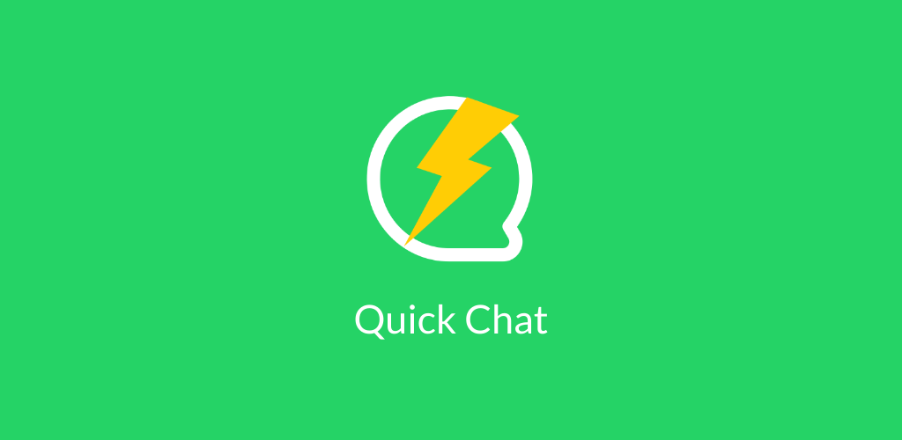
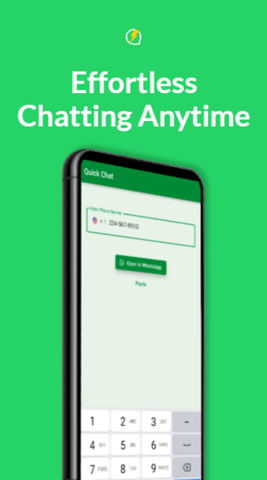
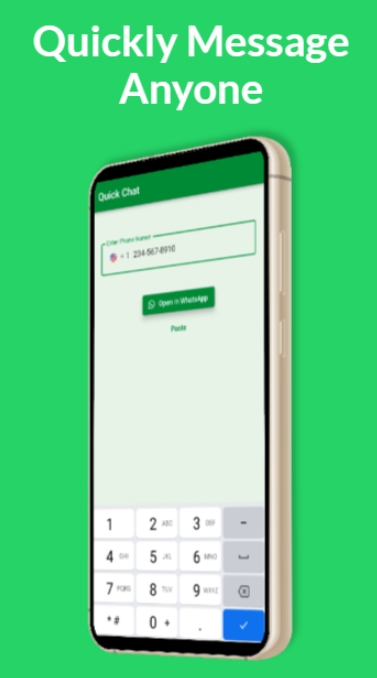

# Quick Chat

> Chat with any number without adding it to your contacts.

Have you ever wanted to chat with someone but didn't want to add them as a contact?
Quick Chat is here for the rescue!

Type (or paste) the number you want to chat with and let the magic happen 🙂.

## Screenshots

## Links

- Android: <https://play.google.com/store/apps/details?id=com.wilmarques.quick_chat>
- PWA: <https://wil.marques.dev/quick-chat/>

## Android deployment

The Build and Release workflow publishes the signed Android App Bundle directly
to Google Play **Internal testing** when a Release Please release is created.
Pull requests and ordinary pushes only build and test; they never publish.
The APK and AAB remain available as the `android-release` workflow artifact.

### One-time setup

1. In [Google Play Console](https://play.google.com/console/), prepare the existing
   `com.wilmarques.quick_chat` app for releases: complete required declarations,
   configure Play App Signing and the internal testing tester list. The upload
   keystore below must match the app's registered upload certificate.
2. Follow Google's [API access setup](https://developers.google.com/android-publisher/getting_started):
   enable the Google Play Android Developer API in a Google Cloud project, create
   a service account, and invite its email in Play Console's **Users and permissions**.
   Restrict its access to this app, with **View app information (read-only)** and
   **Release apps to testing tracks** permissions; production release permission
   is not needed.
3. Enable the [IAM Service Account Credentials API](https://console.cloud.google.com/apis/library/iamcredentials.googleapis.com)
   and grant the service account **Service Account Token Creator** on itself,
   as required by [Google's authentication action](https://github.com/google-github-actions/auth#inputs-service-account-key-json)
   to mint an access token. Create a JSON key for this service account.
4. Add these [repository Actions secrets](https://github.com/wilmarques/quick-chat/settings/secrets/actions):

   | Secret | Value |
   | --- | --- |
   | `ANDROID_KEYSTORE_BASE64` | Base64-encoded upload keystore |
   | `ANDROID_KEYSTORE_PASSWORD` | Upload keystore password |
   | `ANDROID_KEY_ALIAS` | Upload key alias |
   | `ANDROID_KEY_PASSWORD` | Upload key password |
   | `GOOGLE_PLAY_SERVICE_ACCOUNT_JSON` | Service account JSON key (preferably minified) |

   Keep the signing secrets at repository scope: the build job does not use an
   environment. The Google Play JSON secret can instead be scoped to the
   `google-play` [environment](https://github.com/wilmarques/quick-chat/settings/environments).
   Restrict that environment to `main` and add approval rules if desired.
   Never commit the keystore or service account key.
5. Ensure the next Release Please-managed `pubspec.yaml` build number exceeds
   every version code already uploaded to Play. Do not override or manually bump
   versions in this workflow; reconcile any existing Play version history before
   the first automated release.

Publishing uploads the AAB, assigns its returned version code to the `internal`
track with status `completed`, and commits the edit. It does not promote to
production. Missing credentials or Play API errors fail the workflow rather
than silently skipping deployment. If Play reports changes already in review,
wait for or resolve that review before retrying; the workflow does not cancel
reviews or fall back to an unpublished draft. Google Play review and processing
may still delay availability to testers.
